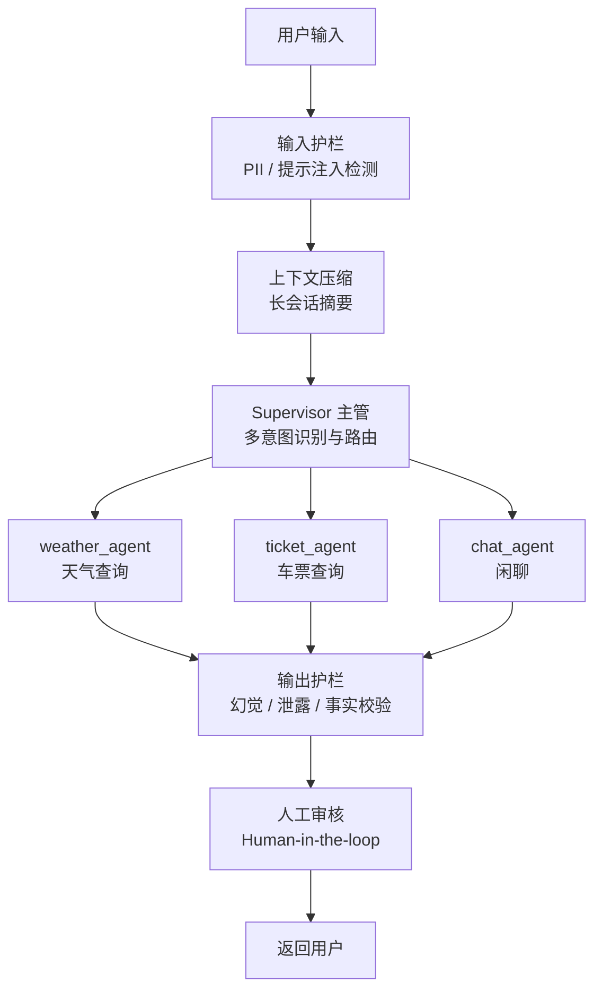

# 🚄 旅行助手 AI Agent

基于 **LangGraph 1.0 + MCP 协议** 的生产级多 Agent 旅行助手，支持天气查询、12306 火车票查询与闲聊对话。项目重点不在「调通一个 RAG」，而在 **LLM Agent 的工程化治理**：安全护栏、可观测性、可靠性、并发与评测。

> 本项目以天气、车票、闲聊作为示例场景，旨在验证多 Agent 协作架构的通用性。核心架构（Supervisor 动态路由、Harness 双层护栏、上下文压缩、Human-in-the-loop）可直接迁移至医疗咨询、金融风控、企业客服等复杂业务场景。

## 项目亮点（TL;DR）

- **多 Agent 编排**：Supervisor 主管 + 3 个专职 Worker（天气 / 车票 / 闲聊），动态多意图路由与结果聚合
- **安全护栏**：输入侧 PII / 提示注入检测，输出侧幻觉 / 提示词泄露 / 事实性校验，规则 + LLM 语义双轨判定，支持 `fail-open / fail-closed`
- **驾驭工程（Harness）**：动态规划、反思循环、可观测性、人工审核（Human-in-the-loop）
- **可靠性**：工具调用失败分类 + 指数退避重试，护栏降级策略，护栏模型独立部署（降低延迟与成本）
- **评测体系**：`eval.py` 一键跑出准确率 / 召回 / F1 / 幻觉率 / 延迟百分位 / Token 消耗 / 工具成功率
- **并发治理**：内置工具去阻塞（线程池）、会话检查点多后端（Redis / SQLite / Postgres）、Web 层滑动窗口限流
- **66 个单元 / 集成测试**，GitHub Actions CI 全绿

## 架构

### 多 Agent 工作流



单 Agent 模式（`agent.multi_agent: false`）则为经典流水线：`意图分析 → 参数规范化 → 工具路由 → 执行 → 反思 → 生成 → 护栏`，同一套 Harness 层复用。

### 技术栈

- **LangGraph 1.0**：状态图编排，条件分支，检查点持久化
- **MCP（Model Context Protocol）**：标准化工具调用，支持多服务器 stdio 传输
- **LangChain + OpenAI / Anthropic**：LLM 集成，主模型与护栏模型解耦
- **FastAPI + Uvicorn**：Web 服务，异步接口
- **Redis / SQLite / Postgres**：会话检查点后端
- **LangSmith**：云端追踪与评测（可选，可关闭）

## 核心模块

| 模块 | 职责 | 位置 |
|------|------|------|
| 多 Agent 编排 | Supervisor 路由 + Worker 构建 | `agent/multiagent/` |
| 安全护栏 | 输入 / 输出检测，规则 + LLM 语义判定 | `agent/harness/guardrails.py` |
| 反思循环 | 空结果 / 工具错误重试 | `agent/harness/reflection.py` |
| 动态规划 | 多步计划 + CoT | `agent/harness/planner.py` |
| 参数规范化 | 日期 / 城市名归一化子图 | `agent/harness/param_normalize.py` |
| 可观测性 | span 追踪 + token 计量 + 延迟统计 | `agent/harness/observability.py`、`agent/metrics.py` |
| 长期记忆 | 事实固化 + 跨会话召回 | `agent/memory.py` |
| 会话检查点 | Redis / SQLite / Postgres / 内存 | `agent/checkpoint.py` |
| MCP 客户端 | 多服务器管理、失败分类、退避重试 | `agent/mcp_client.py` |

## 快速开始

### 1. 环境要求

- Python 3.10+
- （可选）Redis：`backend=redis` 时用于多进程共享会话检查点

### 2. 安装

```bash
pip install -r requirements.txt
pip install -r requirements-dev.txt   # 开发 / 测试依赖
```

### 3. 配置

```bash
cp .env.example .env
```

编辑 `.env` 填入 LLM 配置（支持 OpenAI / DeepSeek / 硅基流动等任何 OpenAI 兼容接口）：

```ini
OPENAI_API_KEY=sk-xxx
OPENAI_BASE_URL=https://api.openai.com/v1
OPENAI_MODEL=gpt-4o
```

### 4. 运行

```bash
# 交互式 CLI
python main.py

# Web 服务（FastAPI，默认端口 8092，可用 PORT 覆盖）
python web.py
# PORT=18092 python web.py   # Windows 上 8092 若被系统保留，换端口
```

Web 接口：

- `GET /health` / `GET /ready`：健康检查 / 就绪探针
- `POST /api/chat`：对话（`{"message": "...", "thread_id": "..."}`）
- `POST /api/review`：人工审核决策（resume 中断）

## 配置说明

`config.yaml` 关键项：

| 配置 | 说明 |
|------|------|
| `agent.multi_agent` | `true` 多 Agent，`false` 单 Agent 流水线 |
| `agent.checkpoint.backend` | `redis` / `sqlite` / `postgres` / `memory`（可用 `CHECKPOINT_BACKEND` 环境变量覆盖） |
| `guardrail_llm` | 护栏专用模型（独立于主模型，支持 `anthropic` / `openai` 协议） |
| `harness.guardrails` | 输入 / 输出护栏开关与模式（`blocking` / `warning`） |
| `harness.reflection` | 反思重试次数与触发条件 |
| `harness.planner` | 动态规划开关与最大步数 |
| `harness.human_review` | 人工审核开关与意图范围 |
| `context.summarize` | 长会话压缩（token 预算触发） |
| `rate_limit` | Web 层按 IP 滑动窗口限流 |

## 测试

```bash
pytest          # 66 个测试，全部离线（Fake LLM / Fake MCP，无需 API key）
```

CI 在 `push` / `pull_request` 时于 Python 3.11 / 3.12 上自动运行。

## 评测体系

`eval.py` 一键跑出多维指标：

- **正确性**：意图分类命中率、混淆矩阵（4 类 + overall）
- **幻觉率**：诱导编造用例（"北京到火星车票"、"乌有乡天气"等）命中比例
- **延迟**：端到端 P50 / P95 / P99 + 节点级 `duration_ms`
- **Token 消耗**：估算（tiktoken）+ 精确（`usage_metadata`）双轨
- **工具成功率**：成功 / 失败 / 耗时遥测汇总

```bash
python eval.py            # 本地评测
python eval_langsmith.py  # LangSmith 云端回归评测（可选）
```

## 性能与并发治理

针对推理延迟、Token 消耗、工具成功率、上下文漂移四类问题做了系统性治理：

| 问题 | 手段 |
|------|------|
| 推理延迟 | 判定类任务（Supervisor / 护栏）`temperature=0` 去采样；护栏独立用快模型（实测端到端 24s → 15.7s） |
| Token 消耗 | 长会话按 token 预算触发压缩（`max_tokens: 6000`），`RemoveMessage` 删旧消息 |
| 工具成功率 | 反思循环 + 参数自适应重试（加"市"/"站"后缀、交换起终点） |
| 上下文漂移 | 摘要 + 长期记忆召回预防，`drift_check` LLM 检测 |
| 并发阻塞 | 内置天气工具从「假异步」改为线程池执行，避免阻塞事件循环 |

> 注：`scripts/loadtest.py` 提供压测脚本，可测 Web 层吞吐上限与端到端延迟。

## Docker

```bash
docker build -t travel-agent .
docker run -p 8092:8092 \
  -e OPENAI_API_KEY=sk-xxx -e OPENAI_BASE_URL=... -e OPENAI_MODEL=... \
  -e CHECKPOINT_BACKEND=memory \
  travel-agent
```

容器内默认 `CHECKPOINT_BACKEND=memory`（无 Redis 时）；如需 Redis，加 `-e CHECKPOINT_BACKEND=redis -e REDIS_URL=redis://<host>:6379`。

## 已知限制

- **12306 MCP 服务器为 Windows 专用**（`mcp-server-12306` 仅提供 Windows 可执行文件），Docker / Linux 环境下车票查询不可用，天气与闲聊正常；`required: false` 保证启动不阻塞
- LangSmith 自托管需企业 License，默认走 SaaS（`LANGSMITH_ENABLED=true`）

## 项目结构

```
travel_agent/
├── agent/
│   ├── multiagent/          # 多 Agent：supervisor / skills / tools / graph
│   ├── harness/             # 驾驭工程：guardrails / planner / reflection / observability
│   ├── graph.py             # 单 Agent 工作流图
│   ├── nodes.py             # 意图分析 / 路由 / 执行 / 生成节点
│   ├── mcp_client.py        # MCP 多服务器客户端（失败分类 + 退避重试）
│   ├── memory.py            # 长期记忆（事实固化 + 召回）
│   ├── checkpoint.py        # 会话检查点工厂（redis/sqlite/postgres/memory）
│   ├── metrics.py           # token 计量 / 工具与模型耗时统计
│   └── builtin_tools.py     # 内置天气工具
├── scripts/
│   ├── loadtest.py          # 压测脚本
│   ├── push_prompts.py      # prompt 上传
│   └── redteam_guardrails.py # 红队护栏测试
├── tests/                   # 66 个单元 / 集成测试
├── eval.py / eval_langsmith.py  # 评测
├── main.py                  # CLI 入口
├── web.py                   # FastAPI Web 服务
├── config.yaml              # 配置
├── Dockerfile               # 容器化
└── .github/workflows/ci.yml # CI
```
